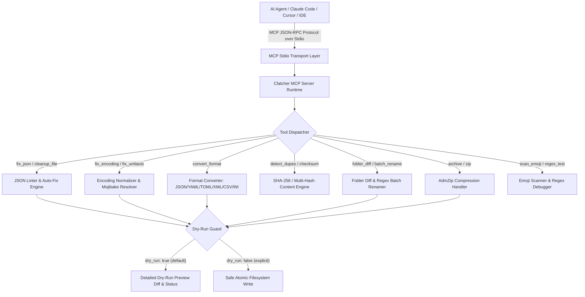
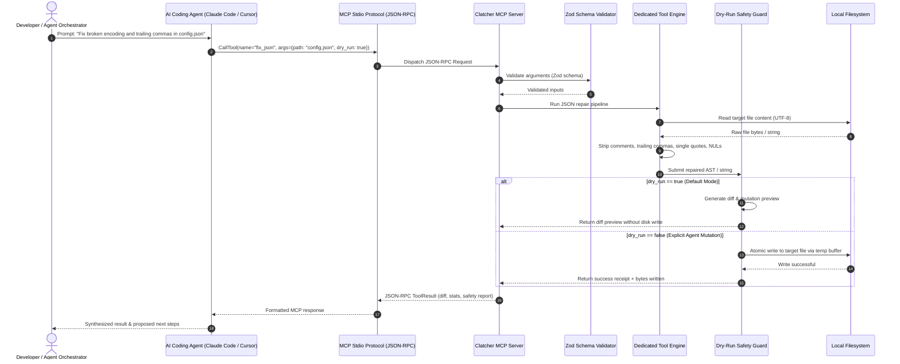

<p align="center">
  
</p>

# ellmos-clatcher-mcp

**🇬🇧 [Versión en inglés](README.md)** | **🇩🇪 [Versión en alemán](README_de.md)** | **🤝 [Contribuir](CONTRIBUTING.md)** | **🛡️ [Política de seguridad](SECURITY.md)** | **📜 [Licencias](THIRD_PARTY_LICENSES.md)** | **📝 [Registro de cambios](CHANGELOG.md)** | **📋 [llms.txt](llms.txt)**

[](https://www.npmjs.com/package/ellmos-clatcher-mcp)
[](https://opensource.org/licenses/MIT)
[](https://nodejs.org/)
[](https://github.com/ellmos-ai/ellmos-clatcher-mcp)
[](https://github.com/ellmos-ai/ellmos-clatcher-mcp/actions/workflows/tests.yml)
[](vitest.config.ts)
[](SECURITY.md)
[](SECURITY.md)
[](SECURITY.md)
[](NOTICE)
[](THIRD_PARTY_LICENSES.md)
[](CONTRIBUTING.md)
[](MARKETING-LOG.txt)
[](CHANGELOG.md)
[](MARKETING-LOG.txt)
[](server.json)
[](glama.json)
[](llms.txt)
[](https://github.com/ellmos-ai)
[](https://github.com/open-bricks)

**Claude Patcher** es un servidor MCP que amplía los agentes de programación con IA con herramientas de utilidad que no incluyen de forma nativa: reparación de archivos, conversión de formatos, detección de duplicados, operaciones por lotes y más.

Usa Clatcher cuando tu agente necesite herramientas locales y fiables para el mantenimiento de archivos de texto, archivos de datos y carpetas de proyectos: reparar JSON no válido, normalizar codificaciones, convertir formatos, comparar carpetas, renombrar archivos de forma segura y verificar sumas de comprobación sin salir del flujo de trabajo de MCP.

> [!NOTE]
> **Nota sobre la integración con IA / LLM:** Todas las operaciones destructivas (por ejemplo, `batch_rename`, `cleanup_file`, `fix_json`, `fix_encoding`, `fix_umlauts`) usan **modo de simulación predeterminado** (`dry_run: true`). Los agentes autónomos deben especificar explícitamente `dry_run: false` para ejecutar cambios en el disco.

<a id="sec-01"></a><a id="1-highlights--value-proposition"></a><a id="highlights--value-proposition"></a>
## Características destacadas y propuesta de valor

- **12 herramientas especializadas para agentes**: Amplía Claude Code, Cursor y los agentes MCP con utilidades que no incluyen de fábrica (reparación de JSON, normalización de codificaciones, conversión de formatos, comparación de diferencias, deduplicación y renombrado por lotes con expresiones regulares).
- **Protección predeterminada de simulación**: Las herramientas que modifican archivos se ejecutan en modo de vista previa (`dry_run: true`) de forma predeterminada. Para escribir en disco, los agentes deben indicar `dry_run: false`.
- **100 % local y sin salida de datos**: Ejecución completamente local mediante JSON-RPC por stdio. Sin llamadas de red, sin telemetría en la nube y sin superficie de ataque remota.
- **Operaciones atómicas con archivos**: Antes de reemplazar archivos, todas las modificaciones en disco se escriben en búferes temporales de preparación, lo que evita archivos dañados o truncados.
- **Conservación de codificación sin pérdidas**: Elimina artefactos de Windows cp1252, encabezados BOM y texto corrupto de los caracteres alemanes (`ä, ö, ü, ß`) y garantiza bytes UTF-8 limpios.
- **Compatibilidad uniforme entre sistemas operativos**: Se prueba continuamente en Ubuntu, Windows y macOS, con gestión nativa de rutas y finales de línea.

## 🧭 Navegación rápida

| # | Sección | Enfoque |
|---|---|---|
| 01 | [✨ Características destacadas y propuesta de valor](#highlights--value-proposition) | 12 herramientas esenciales que los agentes de IA no suelen tener: reparación, conversión, deduplicación, comparación y operaciones por lotes |
| 02 | [🎯 Perfiles objetivo y visibilidad](#target-personas--discoverability) | Agentes autónomos, desarrolladores full stack, ingenieros de publicación y responsables de seguridad y cumplimiento |
| 03 | [⚖️ Matriz comparativa y alternativas](#comparative-matrix--alternatives) | Evaluación en 10 dimensiones frente a shells de agentes estándar, jq/sed ad hoc, aplicaciones de escritorio y API en la nube |
| 04 | [📐 Arquitectura del sistema y flujo de datos](#system-architecture--data-flow) | Diagrama de flujo de arquitectura en cinco capas para el transporte stdio y los motores de reparación |
| 05 | [🔄 Secuencia de ejecución de principio a fin](#end-to-end-execution-sequence) | Diagrama de 14 pasos del protocolo de seguridad en modo de simulación: desde la instrucción del usuario hasta la escritura verificada en disco |
| 06 | [🛡️ Invariantes fundamentales y garantías de seguridad](#core-invariants--safety-guarantees) | 10 garantías arquitectónicas que aseguran la simulación predeterminada, la ausencia de tráfico saliente y las escrituras atómicas |
| 07 | [🛠️ Herramientas y capacidades](#tools) | Descripción detallada de las 12 herramientas MCP, sus esquemas de parámetros y sus modos de vista previa predeterminados |
| 08 | [⚙️ Instalación y configuración de clientes](#installation) | Configuración sencilla para Claude Code CLI, Claude Desktop, Cursor y npm global |
| 09 | [💡 Flujos de uso prácticos](#practical-usage-workflows) | Recetas paso a paso para reparación con agentes: arreglar JSON, normalizar codificaciones y renombrar por lotes |
| 10 | [🛡️ Protocolo de simulación y verificación de seguridad](#dry-run-protocol) | Mecánica de verificación que prioriza la vista previa y controles de escritura en disco que fallan de forma segura |
| 11 | [🔤 Codificación, mojibake y conversión de formatos](#encoding-engine) | Normalización UTF-8 sin pérdidas, eliminación de BOM, caracteres alemanes con diéresis y transformaciones de formato |
| 12 | [💻 Compatibilidad multiplataforma y rutas sólidas en Windows](#platform-parity) | Gestión determinista de rutas con finales CRLF en Windows, LF en Linux y los entornos de macOS |
| 13 | [🌐 Familia MCP de ellmos y matriz de proyectos hermanos](#ellmos-mcp-family) | 9 servidores MCP hermanos con más de 200 herramientas especializadas para agentes |
| 14 | [🧱 Ecosistema y conjuntos asociados](#ellmos-ai-ecosystem) | Integración con las suites de escritorio open-bricks, el sistema de texto BACH y las herramientas dev-bricks |
| 15 | [🔒 Política de seguridad e informe de incidentes](#security-policy) | Política de seguridad bilingüe, comunicación privada de vulnerabilidades y SLA de respuesta de 48 horas |
| 16 | [📋 Contexto legible por máquinas (llms.txt)](#machine-readable-context-llmstxt) | Índice LLM estandarizado para descubrimiento por agentes y rastreadores RAG |
| 17 | [🧪 Verificación y pruebas automatizadas](#testing) | Más de 172 pruebas Vitest, paridad al 100 % y matriz de CI multiplataforma para Node.js 20, 22 y 24 |
| 18 | [⚖️ Licencias de terceros y transparencia](#third-party-licenses--transparency) | SBOM permisiva de nivel 1 al 100 %, atribución en NOTICE y descargo de responsabilidad legal según § 521 BGB |

<a id="sec-02"></a><a id="2-target-personas--discoverability"></a><a id="target-personas--discoverability"></a>
## Perfiles objetivo y visibilidad

| Perfil | Necesidades principales | Problemas que resuelve | Términos de búsqueda objetivo |
|---|---|---|---|
| **Agentes autónomos de IA y enjambres** | Reparación de archivos no destructiva, simulaciones que priorizan la vista previa y recibos de estado deterministas | JSON malformado que detiene los ciclos de agentes y mojibake de codificación sin tratar que corrompe archivos del proyecto | `mcp json repair tool`, `local-first mcp file utilities`, `dry-run safe agent tools` |
| **Desarrolladores full stack** | Conversión rápida de configuraciones entre varios formatos (JSON/YAML/TOML/XML) y renombrado masivo con expresiones regulares | Sintaxis CLI engorrosa que exige varias herramientas, ciclos tediosos de expresiones regulares y contaminación con finales CRLF de Windows o BOM | `json to toml mcp`, `yaml xml conversion tool`, `batch regex rename mcp` |
| **Ingenieros de DevOps y de publicación** | Sumas de comprobación automatizadas con varios hashes (SHA-256/SHA-512), comparación de carpetas e inspección de ZIP | Divergencias de herramientas en los ejecutores de CI, hashes de paquetes sin verificar y utilidades externas de archivo demasiado pesadas | `mcp sha256 checksum`, `folder diff mcp tool`, `zip archive mcp runner` |
| **Responsables de seguridad y cumplimiento** | Ejecución stdio aislada, 100 % local y sin telemetría; licencias permisivas auditadas | Telemetría oculta que contacta con servidores externos, licencias desconocidas en la cadena de suministro y tráfico de red saliente sin control | `zero-egress mcp server`, `local-first claude mcp`, `permissive license mcp tools` |

<a id="sec-03"></a><a id="3-comparative-matrix--alternatives"></a><a id="comparative-matrix--alternatives"></a>
## Matriz comparativa y alternativas

| Dimensión | ellmos-clatcher-mcp | Shell de agente estándar | CLI ad hoc (jq/sed) | Aplicaciones de escritorio pesadas | Convertidores / API en la nube |
|---|---|---|---|---|---|
| **Interfaz principal** | MCP Stdio nativo (JSON-RPC) | Shell en bruto / ejecución Bash | CLI independiente en terminal | Ventana de aplicación gráfica | REST HTTP / página web |
| **Protecciones de seguridad** | `dry_run: true` integrada de forma predeterminada | Riesgo de sobrescritura a ciegas | Escrituras de shell sin verificar | Confirmación manual en GUI | Almacenamiento en servidor remoto |
| **Privacidad de datos y salida de red** | 100 % local / sin tráfico saliente | Ejecución local | Ejecución local | Ejecución local | Carga en una nube remota |
| **Reparación automática de JSON** | Reparación heurística con 6 reglas | Regeneración del archivo completo | Scripts JQ complejos | Edición manual de la sintaxis | Pegar el contenido en un sitio web de terceros |
| **Normalización de codificaciones** | Reparación de mojibake sin pérdidas | Adivinación / iconv | CLI de iconv / enca | Cambio manual de codificación del archivo | UTF-8 web inconsistente |
| **Conversión entre varios formatos** | JSON/YAML/TOML/XML/CSV/INI | Reescritura de instrucciones | Paquetes CLI separados | Exportaciones de archivos complejas | API en la nube con límites de uso |
| **Detección de duplicados** | Agrupación por hash SHA-256 | Ninguna (script personalizado) | Bash / find personalizado | Herramienta independiente (Anti-D) | No compatible |
| **Renombrado por lotes con expresiones regulares** | Renombrador por etapas con simulación | Bucle secuencial de «mv» | Scripts rename / sed | Utilidad gráfica para renombrar en bloque | No compatible |
| **Paridad entre sistemas operativos** | Windows, Linux y macOS | Particularidades de sintaxis del shell | Conjuntos de herramientas centrados en Linux | Binarios específicos de cada sistema operativo | Depende del navegador |
| **Licencia y seguridad auditada** | MIT / BSD 100 % permisivas | Variable / sin auditar | GPL / cadenas de herramientas mixtas | Mixta / propietaria | SaaS comercial cerrado |

<a id="sec-04"></a><a id="4-system-architecture--data-flow"></a><a id="system-architecture--data-flow"></a>
## Arquitectura del sistema y flujo de datos

### Topología arquitectónica en cuatro vistas (ASCII)

```text
+--------------------------------------------------------------------------------------------------+
|                              ELLMOS CLATCHER MCP ARCHITECTURAL TOPOLOGY                          |
+--------------------------------------------------------------------------------------------------+
| [VIEW 1: CALLER RUNTIMES & AGENT CLIENTS]                                                        |
|   * Autonomous Agents   : Claude Code, OpenAI Codex, Antigravity / Gemini, Kimi, Cursor          |
|   * Agent Frameworks    : AutoGen, CrewAI, LangChain, LlamaIndex, Custom Python / TS Clients    |
|   * Transport Protocols : Model Context Protocol (MCP stdio), JSON-RPC 2.0 Framing               |
|   * Tool Surface        : 12 Specialized Agent Tools (file repair, formatting, hash & archives)  |
|   * Schema Contract     : Stdio transport, dynamic runtime Zod schema validation & parameter guards|
+--------------------------------------------------------------------------------------------------+
|                                                |                                                 |
|                                                v                                                 |
+--------------------------------------------------------------------------------------------------+
| [VIEW 2: CLATCHER MCP CORE ENGINE & TOOL DISPATCH ORCHESTRATOR]                                  |
|   * Protocol Dispatch   : ESM stdio router with Zod schema validation & parameter checking      |
|   * Safety Interceptor  : Built-in Dry-Run Guard (INV-DRYRUN-01) defaulting mutating tools to preview|
|   * Fault Diagnostics   : Multi-pass JSON syntax linter & self-healing AST repair pipeline       |
|   * Encoding Resolver   : Lossless UTF-8 normalization, BOM stripper & German umlaut Mojibake fix|
|   * Format Converter    : Bi-directional translation across 6 formats (JSON, YAML, TOML, XML...)|
+--------------------------------------------------------------------------------------------------+
|                                                |                                                 |
|                                                v                                                 |
+--------------------------------------------------------------------------------------------------+
| [VIEW 3: RUNTIME UTILITIES, FORMAT CONVERTERS & ATOMIC REPAIR PIPELINE]                          |
|   * Atomic File Ops     : Staged temporary buffer writes before replacement (INV-ATOMIC-04)      |
|   * Traversal Guard     : Archive extraction & batch rename strictly bounded to root trees       |
|   * Duplication Analysis: Collision-resistant SHA-256 cluster detection across workspace files   |
|   * Cryptographic Hashes: Native multi-algorithm digest verification (SHA-256, SHA-512, MD5, SHA-1)|
|   * Directory Diffs     : Fast recursive folder structural and content delta comparison engine   |
|   * In-Memory Archives  : Streamlined ZIP creation, inspection, and extraction with adm-zip      |
+--------------------------------------------------------------------------------------------------+
|                                                |                                                 |
|                                                v                                                 |
+--------------------------------------------------------------------------------------------------+
| [VIEW 4: AIR-GAP DEFENSE PERIMETER, RUNASINVOKER & ZERO-EGRESS GOVERNANCE]                       |
|   * Execution Privilege : RunAsInvoker unprivileged user-mode (Zero administrative elevation)    |
|   * Transport Boundary  : 100% Local stdio transport, zero telemetry, zero open listening ports  |
|   * Air-Gap Isolation   : 100% Offline execution, zero outbound network sockets, zero egress     |
|   * Statutory Protection: § 521 BGB gratuitous open-source liability disclaimer & 48h SLA        |
|   * Governance & Supply : Level 1 SBOM, 100% permissive runtime (MIT/BSD), NOTICE attribution    |
+--------------------------------------------------------------------------------------------------+
```

### Diagrama del flujo de datos de los componentes



<a id="sec-05"></a><a id="5-end-to-end-execution-sequence"></a><a id="end-to-end-execution-sequence"></a>
### Secuencia de ejecución de principio a fin



<a id="sec-06"></a><a id="6-core-invariants--safety-guarantees"></a><a id="core-invariants--safety-guarantees"></a>
## Invariantes fundamentales y garantías de seguridad

| Invariante | Garantía | Mecanismo de aplicación |
|---|---|---|
| **Protección de simulación predeterminada** | Las herramientas de modificación nunca cambian archivos de forma silenciosa | Todas las herramientas de modificación (`batch_rename`, `cleanup_file`, `fix_json`, `fix_encoding`, `fix_umlauts`, `convert_format`, `archive`) usan `dry_run: true` de forma predeterminada. Para confirmar los cambios, se debe indicar explícitamente `dry_run: false`. |
| **Sin tráfico saliente y ejecución local** | Sin telemetría externa ni llamadas de red | Procesamiento completamente desconectado mediante stdio JSON-RPC. Sin señales de telemetría, sin solicitudes a API externas y sin conexiones de red salientes. |
| **Protección contra recorrido de rutas** | Confinamiento estricto a los árboles de archivos autorizados | Las operaciones de archivado y las operaciones por lotes validan los límites de destino y resuelven de forma segura las rutas relativas respecto a los directorios raíz. |
| **Operaciones atómicas** | Resistencia ante escrituras interrumpidas | Antes de reemplazar los destinos, los flujos de modificación escriben en archivos temporales preparados, lo que evita resultados parciales o dañados. |
| **Modo de usuario sin elevación** | Requiere privilegios mínimos del sistema operativo | Se ejecuta con los permisos estándar del usuario, sin solicitar privilegios de sudo o Administrador. |
| **Conservación de codificación** | Conversión de caracteres de ida y vuelta sin pérdidas | Corrige artefactos de Windows cp1252, problemas de BOM y caracteres alemanes con diéresis (`ä, ö, ü, ß`) y conserva intacto el orden de los bytes UTF-8. |
| **Integridad con varios hashes** | Verificación criptográfica a nivel de bits | Validación de sumas de comprobación con los algoritmos SHA-256, SHA-512, MD5 y SHA-1. |
| **Paridad entre sistemas operativos** | Comportamiento idéntico en distintas plataformas | Pruebas continuas en Linux (`ubuntu-latest`), Windows (`windows-latest`) y macOS (`macos-latest`), con gestión nativa de separadores de ruta. |
| **Validación de argumentos con cierre seguro** | Los parámetros no válidos se rechazan antes de ejecutar | La validación de esquemas Zod impone límites estrictos, rechaza rutas y tipos malformados y evita ejecuciones parciales. |
| **Límites de error y recibos deterministas** | Informes de diagnóstico estructurados en todas las ejecuciones | Contratos invariantes de respuesta de las herramientas: cada invocación devuelve cargas JSON-RPC estructuradas, vistas previas de diferencias, recuentos de bytes y recibos verificables. |

<a id="sec-07"></a><a id="7-tool-surface--capabilities"></a><a id="tools"></a>
## Herramientas

| Herramienta | Descripción |
|---|---|
| `fix_json` | Repara JSON dañado: elimina comentarios, comas finales, comillas simples, BOM y NUL |
| `fix_encoding` | Corrige problemas de codificación: elimina BOM, repara UTF-8 codificado dos veces y artefactos cp1252 |
| `fix_umlauts` | Corrige diéresis alemanas dañadas por doble codificación (por ejemplo, `ä` -> `ä`) |
| `convert_format` | Convierte entre JSON, YAML, TOML, XML, CSV e INI |
| `detect_dupes` | Busca archivos duplicados mediante hash de contenido (SHA256) y los agrupa por contenido idéntico |
| `folder_diff` | Compara dos directorios, o toma una instantánea y calcula las diferencias en la siguiente llamada |
| `batch_rename` | Renombra archivos mediante patrones de expresiones regulares con vista previa de simulación |
| `archive` | Crea, extrae o enumera archivos ZIP |
| `checksum` | Calcula hashes de archivos (SHA256, MD5, SHA1, SHA512) con verificación opcional |
| `cleanup_file` | Elimina BOM y espacios finales, corrige finales de línea y quita bytes NUL |
| `scan_emoji` | Busca caracteres emoji en archivos de código |
| `regex_test` | Prueba patrones de expresiones regulares en texto y muestra todas las coincidencias con sus grupos |

Todas las herramientas destructivas usan **modo de simulación predeterminado** y requieren `dry_run: false` de forma explícita para escribir los cambios.

<a id="sec-08"></a><a id="8-installation--client-setup"></a><a id="installation"></a>
## Instalación

### CLI de Claude Code

```bash
claude mcp add ellmos-clatcher-mcp -- npx ellmos-clatcher-mcp
```

### Configuración de Claude Desktop / Cursor
Añade Clatcher a la configuración MCP de `claude_desktop_config.json` o de Cursor:

```json
{
  "mcpServers": {
    "clatcher": {
      "command": "npx",
      "args": ["-y", "ellmos-clatcher-mcp"]
    }
  }
}
```

### npm (global)

```bash
npm install -g ellmos-clatcher-mcp
claude mcp add ellmos-clatcher-mcp -- ellmos-clatcher
```

### Desde el código fuente

```bash
git clone https://github.com/ellmos-ai/ellmos-clatcher-mcp.git
cd ellmos-clatcher-mcp
npm install
npm run build
node dist/index.js
```

<a id="sec-09"></a><a id="9-practical-usage-workflows"></a><a id="practical-usage-workflows"></a>
## Flujos de uso prácticos

Clatcher ofrece acciones de utilidad deterministas, de un solo paso, adaptadas a los flujos de trabajo de programación con IA:

### 1. Reparación automática de JSON (`fix_json`)
Los agentes autónomos suelen encontrarse con archivos de configuración que contienen comas finales, claves entre comillas simples o comentarios de JavaScript en línea:
```json
{
  "name": "fix_json",
  "arguments": {
    "path": "tsconfig.json",
    "dry_run": false
  }
}
```
*Resultado:* Se analizan y eliminan los comentarios y las comas finales para generar JSON estricto y conforme a la especificación, con los bytes escritos verificables.

### 2. Normalización de codificación de caracteres sin pérdidas (`fix_encoding` / `fix_umlauts`)
Corrige artefactos de Windows cp1252, encabezados BOM y secuencias UTF-8 codificadas dos veces, sin perder datos:
```json
{
  "name": "fix_umlauts",
  "arguments": {
    "path": "docs/Anleitung.md",
    "dry_run": false
  }
}
```
*Resultado:* Las secuencias dañadas, como `ä`, `ö`, `ü` y `ß`, se convierten de nuevo a UTF-8 limpio: `ä`, `ö`, `ü` y `ß`.

### 3. Conversión de configuraciones entre varios formatos (`convert_format`)
Convierte datos estructurados entre JSON, YAML, TOML, XML, CSV e INI en una sola pasada:
```json
{
  "name": "convert_format",
  "arguments": {
    "input_path": "config.yaml",
    "output_path": "config.json",
    "input_format": "yaml",
    "output_format": "json",
    "dry_run": false
  }
}
```

### 4. Detección de duplicados y hashing criptográfico (`detect_dupes` / `checksum`)
Analiza los árboles de directorios de destino para identificar contenido idéntico mediante agrupación por hash SHA-256, sin transmitir datos por la red:
```json
{
  "name": "detect_dupes",
  "arguments": {
    "directory": "src/assets"
  }
}
```

### 5. Renombrado seguro por lotes con expresiones regulares (`batch_rename`)
Vista previa y preparación de renombrados de archivos por lotes mediante patrones de expresiones regulares:
```json
{
  "name": "batch_rename",
  "arguments": {
    "directory": "reports",
    "pattern": "^draft_(.*)\\.txt$",
    "replacement": "final_$1.txt",
    "dry_run": true
  }
}
```

<a id="sec-10"></a><a id="10-dry-run-protocol--safety-verification"></a><a id="dry-run-protocol"></a>
## Protocolo de simulación y verificación de seguridad

Todas las herramientas que modifican datos en `ellmos-clatcher-mcp` aplican un **contrato que prioriza la vista previa** (`dry_run: true` de forma predeterminada):

1. **Vista previa de seguridad:** Al invocar `fix_json`, `cleanup_file`, `batch_rename`, `fix_encoding` o `archive` sin argumentos, se muestra una diferencia unificada detallada y una vista previa de los cambios, sin tocar el disco.
2. **Consentimiento explícito:** El sistema de archivos solo se modifica cuando el agente proporciona explícitamente `dry_run: false`.
3. **Validación de argumentos con cierre seguro:** Los parámetros de ruta se depuran estrictamente para impedir recorridos de ruta (`..` escapes) y se limitan a los directorios del proyecto.
4. **Generación de recibos:** Cada ejecución que modifica datos genera un registro JSON de referencia de la ejecución, con los bytes leídos y escritos y el estado de verificación criptográfica.

<a id="sec-11"></a><a id="11-encoding-mojibake--formatting-engine"></a><a id="encoding-engine"></a>
## Codificación, mojibake y conversión de formatos

Clatcher incluye primitivas especializadas de manipulación de cadenas para resolver daños de texto entre plataformas:
- **Eliminación de BOM:** Quita automáticamente los encabezados BOM UTF-8 (`0xEF, 0xBB, 0xBF`) que causan fallos en analizadores CLI heredados y validadores de CI.
- **Resolución de mojibake:** Reconstruye secuencias multibyte dañadas por interpretar texto UTF-8 como ISO-8859-1 o Windows-1252.
- **Estandarización de finales de línea:** Convierte archivos con finales Windows CRLF (`\r\n`) y Unix LF (`\n`) mezclados en finales de línea uniformes.
- **Eliminación de bytes NUL:** Limpia caracteres NUL binarios accidentales introducidos por flujos de red interrumpidos o bloques de disco dañados.

<a id="sec-12"></a><a id="12-multi-os-support--windows-path-robustness"></a><a id="platform-parity"></a>
## Compatibilidad multiplataforma y solidez de rutas en Windows

La paridad multiplataforma se verifica continuamente en Linux, macOS y Windows:
- **Normalización de rutas:** Resuelve indistintamente barras invertidas (`\`) y barras normales (`/`) mediante los módulos nativos de Node.js `path`.
- **Compatibilidad con rutas largas:** Opera de forma segura en estructuras anidadas profundas de Windows sin truncarlas por el límite MAX_PATH (260 caracteres).
- **Ejecución sin privilegios elevados:** Funciona con los permisos de usuario estándar (`RunAsInvoker`), sin solicitar privilegios administrativos ni acceso root.

<a id="sec-13"></a><a id="13-ellmos-mcp-family--sibling-matrix"></a><a id="ellmos-mcp-family"></a>
## Familia MCP de ellmos y matriz de proyectos hermanos

Forma parte de la **familia MCP de ellmos**:

| Servidor | Herramientas | Enfoque | npm |
|---|---|---|---|
| [ellmos-filecommander-mcp](https://github.com/ellmos-ai/ellmos-filecommander-mcp) | 50 | Operaciones del sistema de archivos, gestión de procesos y sesiones interactivas | [`ellmos-filecommander-mcp`](https://www.npmjs.com/package/ellmos-filecommander-mcp) |
| [ellmos-codecommander-mcp](https://github.com/ellmos-ai/ellmos-codecommander-mcp) | 22 | Análisis de código, análisis AST y gestión de importaciones | [`ellmos-codecommander-mcp`](https://www.npmjs.com/package/ellmos-codecommander-mcp) |
| **[ellmos-clatcher-mcp](https://github.com/ellmos-ai/ellmos-clatcher-mcp)** | **12** | **Herramientas de utilidad: reparar, convertir, detectar y operar por lotes** | **[`ellmos-clatcher-mcp`](https://www.npmjs.com/package/ellmos-clatcher-mcp)** |
| [n8n-manager-mcp](https://github.com/ellmos-ai/n8n-manager-mcp) | 19 | Gestión de flujos de trabajo de n8n mediante asistentes de IA | [`n8n-manager-mcp`](https://www.npmjs.com/package/n8n-manager-mcp) |
| [ellmos-controlcenter-mcp](https://github.com/ellmos-ai/ellmos-controlcenter-mcp) | 34 | Descubrimiento de pilas MCP, gestión de perfiles y plano de control | [`ellmos-controlcenter-mcp`](https://www.npmjs.com/package/ellmos-controlcenter-mcp) |
| [ellmos-homebase-mcp](https://github.com/ellmos-ai/ellmos-homebase-mcp) | 51 | Memoria, conocimiento, estado, enrutamiento y orquestación para LLM | [`ellmos-homebase-mcp`](https://www.npmjs.com/package/ellmos-homebase-mcp) (alfa) |
| [ellmos-servercommander-mcp](https://github.com/ellmos-ai/ellmos-servercommander-mcp) | 8 | Operaciones de servidor: simulaciones de despliegue, estado del correo, análisis de registros y comprobaciones de estado | [`ellmos-servercommander-mcp`](https://www.npmjs.com/package/ellmos-servercommander-mcp) (alfa) |
| [ellmos-blender-use-mcp](https://github.com/ellmos-ai/ellmos-blender-use-mcp) | 4 | Control de calidad de recursos de Blender sin interfaz y verificación de reimportación de FBX | [`ellmos-blender-use-mcp`](https://www.npmjs.com/package/ellmos-blender-use-mcp) (alfa) |
| [open-compute-mcp](https://github.com/ellmos-ai/open-compute-mcp) | 16 | Uso de ordenador independiente del modelo: captura, acciones con controles de seguridad e interfaz UIA de Windows | [`open-compute-mcp`](https://www.npmjs.com/package/open-compute-mcp) (alfa) |

Cada servidor cubre un ámbito diferente. Según el flujo de trabajo, puedes usar uno, una pareja especializada o toda la familia.

<a id="sec-14"></a><a id="14-ecosystem--partner-suites"></a><a id="ellmos-ai-ecosystem"></a>
## Ecosistema ellmos-ai

Este servidor MCP forma parte del ecosistema **[ellmos-ai](https://github.com/ellmos-ai)**: infraestructura de IA, servidores MCP y herramientas inteligentes.

### Infraestructura de IA

| Proyecto | Descripción |
|---------|-------------|
| [BACH](https://github.com/ellmos-ai/bach) | Sistema operativo de texto local para agentes LLM, con más de 113 controladores, 550 herramientas y memoria SQLite |
| [open-compute](https://github.com/ellmos-ai/open-compute) | Núcleo de uso de ordenadores independiente del modelo que impulsa Open Compute MCP |
| [clutch](https://github.com/ellmos-ai/clutch) | Orquestación de LLM independiente del proveedor, con enrutamiento automático y seguimiento de presupuestos |
| [rinnsal](https://github.com/ellmos-ai/rinnsal) | Infraestructura ligera para memoria de agentes, conectores y automatización |
| [ellmos-stack](https://github.com/ellmos-ai/ellmos-stack) | Pila de investigación de IA autoalojada (Ollama + n8n + Rinnsal + KnowledgeDigest) |
| [MarbleRun](https://github.com/ellmos-ai/MarbleRun) | Marco para cadenas de agentes autónomos en Claude Code |
| [gardener](https://github.com/ellmos-ai/gardener) | Prototipo minimalista de sistema operativo LLM basado en base de datos (4 funciones, 1 tabla) |
| [ellmos-tests](https://github.com/ellmos-ai/ellmos-tests) | Marco de pruebas para sistemas operativos LLM (7 dimensiones) |

### Software de escritorio y ecosistema hermano

La organización asociada **[open-bricks](https://github.com/open-bricks)** y sus suites hermanas reúnen aplicaciones nativas de IA y herramientas para desarrolladores:

| Repositorio | Enfoque | Estado |
|---|---|---|
| [file-bricks/ProFiler](https://github.com/file-bricks/ProFiler) | Gestor de archivos de escritorio PySide6 con varias columnas y espacios de trabajo inteligentes | Activo |
| [doc-bricks/DokuZen](https://github.com/doc-bricks/DokuZen) | Conversión de documentos, OCR por lotes y saneamiento de metadatos | Activo |
| [dev-bricks/safe-start-for-codex](https://github.com/dev-bricks/safe-start-for-codex) | Comprobaciones previas seguras del espacio de trabajo y controles de inicio de agentes | Activo |
| [dev-bricks/DevCenter](https://github.com/dev-bricks/DevCenter) | Centro de desarrollo y gestor de servicios | Activo |
| [dev-bricks/CodeBox](https://github.com/dev-bricks/CodeBox) | Ejecución de código aislada y entorno de trabajo en contenedores | Activo |
| [dev-bricks/Zombie Killer Tray](https://github.com/dev-bricks/zombie-killer-tray) | Herramienta opcional de Windows para comprobar procesos MCP huérfanos. Clatcher es un candidato configurado cuando se inicia mediante el punto de entrada compatible `node_modules/ellmos-clatcher-mcp/dist/index.js`; siguen aplicándose todas las comprobaciones adicionales de procesos y aplicación | Opcional |

<a id="sec-15"></a><a id="15-security-policy--incident-reporting"></a><a id="security-policy"></a>
## Política de seguridad

Para consultar los canales de comunicación de vulnerabilidades, las versiones compatibles y el SLA de respuesta de 48 horas, consulta **[SECURITY.md](SECURITY.md)**. Las pautas de desarrollo, los controles de calidad y los contratos de invariantes están en **[CONTRIBUTING.md](CONTRIBUTING.md)**.

<a id="sec-16"></a><a id="16-machine-readable-context-llmstxt"></a><a id="machine-readable-context-llmstxt"></a>
## Contexto legible por máquinas (llms.txt)

Este repositorio incluye un archivo de contexto estandarizado y legible por máquinas para agentes de IA, rastreadores e indexadores RAG:
- **[llms.txt](llms.txt)**: Manifiesto conciso de las 12 herramientas, las invariantes de seguridad del modo de simulación, el recuento de herramientas MCP hermanas y ejemplos de invocación desde CLI.

<a id="sec-17"></a><a id="17-testing-verification--quality-gates"></a><a id="testing"></a>
## Pruebas

```bash
npm test
```

172 pruebas cubren las 12 herramientas, los paquetes de idiomas i18n, la higiene del repositorio y la coherencia de los metadatos (Vitest). El flujo de GitHub Actions ejecuta `npm ci`, la compilación TypeScript, Vitest y una simulación de empaquetado npm en Node.js 20, 22 y 24.

### Requisitos

- Node.js >= 20

### Licencia

[MIT](LICENSE)

<a id="sec-18"></a><a id="18-third-party-licenses--transparency"></a><a id="third-party-licenses--transparency"></a><a id="haftung--liability"></a>
## Licencias de terceros y transparencia

`ellmos-clatcher-mcp` cumple estrictamente las normas de gobernanza de código abierto de open-bricks y ellmos-ai. Sus 7 dependencias directas de ejecución y 5 dependencias de desarrollo tienen licencias 100 % permisivas (MIT, BSD-3-Clause, BSD-2-Clause y Apache-2.0): sin copyleft (0 % GPL/AGPL) y sin telemetría en la nube.

El aviso formal de copyright y la atribución del ecosistema están recogidos en **[`NOTICE`](NOTICE)**. Para consultar el inventario completo de dependencias, los identificadores SPDX, la matriz de correspondencia del SBOM de nivel 1 y los textos íntegros de las licencias, consulta **[THIRD_PARTY_LICENSES.md](THIRD_PARTY_LICENSES.md)** y su versión en texto sin formato **[THIRD_PARTY_LICENSES.txt](THIRD_PARTY_LICENSES.txt)**.

## Visibilidad y descubrimiento

- **npm:** [`ellmos-clatcher-mcp`](https://www.npmjs.com/package/ellmos-clatcher-mcp)
- **GitHub:** [`ellmos-ai/ellmos-clatcher-mcp`](https://github.com/ellmos-ai/ellmos-clatcher-mcp)
- **Metadatos del registro MCP:** [`server.json`](server.json) declara la identidad oficial del paquete `io.github.ellmos-ai/ellmos-clatcher-mcp`.
- **Registro de Glama.ai:** manifiesto de [`glama.json`](glama.json) para el ecosistema MCP de Glama.
- **Índice LLM:** [`llms.txt`](llms.txt) resume las herramientas disponibles para agentes y rastreadores de registros.

Términos de búsqueda principales: `ellmos-clatcher-mcp`, `clatcher mcp`, `claude patcher`, `mcp json repair server`, `mcp encoding fix`, `model context protocol file repair`, `claude code utility tools`, `format conversion mcp tool`, `duplicate file detection mcp`, `batch rename mcp`, `checksum mcp`, `zip archive mcp`.

## Registro de cambios

Para consultar la evolución completa de las versiones, las notas de lanzamiento y las auditorías de higiene, consulta **[CHANGELOG.md](CHANGELOG.md)**.

## Responsabilidad / Exención de responsabilidad

Este proyecto es una **donación de código abierto no remunerada** en el sentido de los §§ 516 y siguientes del Código Civil alemán (BGB). Conforme al **§ 521 BGB**, la responsabilidad del autor se limita al dolo y la negligencia grave. También se aplica la exclusión de garantías de la licencia MIT.

El uso corre por cuenta y riesgo del usuario. No se garantiza el mantenimiento ni la disponibilidad, ni la ausencia de errores o la aptitud para un propósito determinado.

Este proyecto es una donación de código abierto no remunerada conforme al derecho alemán. La responsabilidad se limita al dolo y a la negligencia grave (§ 521 del Código Civil alemán). Se aplica la exclusión de garantías de la licencia MIT.

El uso corre por cuenta y riesgo del usuario. No se garantiza la prestación de mantenimiento ni la disponibilidad, ni la ausencia de errores o la idoneidad para un fin determinado.
